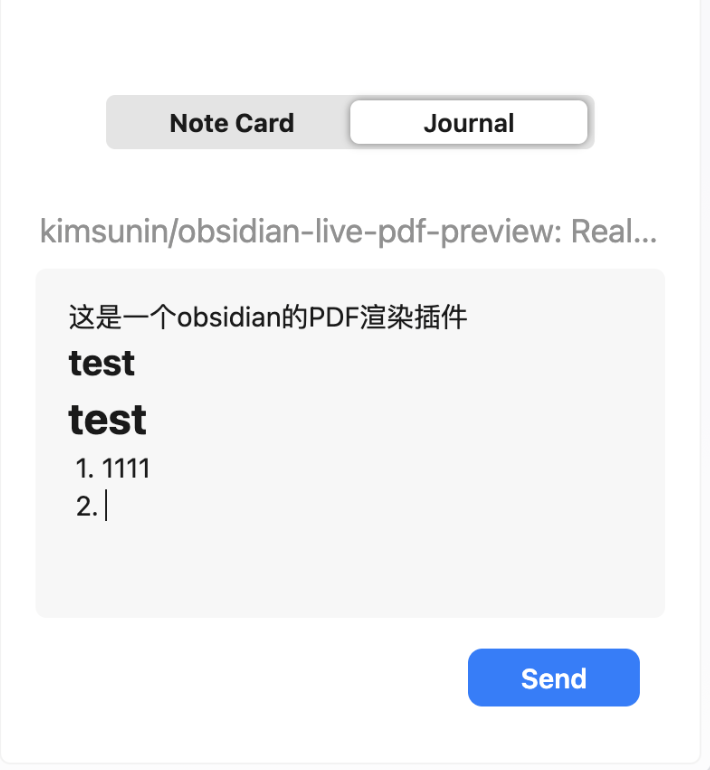

# Side Heptabase

中文说明: [README.zh.md](README.zh.md)

<p align="center">
  
</p>

I built Side Heptabase for people who read and research in Chrome but want their notes to land in Heptabase without breaking focus. Capturing the thought, preserving its source, and choosing the right destination are small decisions that become friction when repeated all day. This extension distills a workflow I use in real browsing sessions into one side panel. AI can help shape a note, but it does not replace the judgment behind what is worth keeping; it amplifies that judgment when capture stays lightweight.

Side Heptabase is an unofficial Chrome side-panel extension for writing Markdown and sending it directly to a new Heptabase Note Card or today's Journal, with the current page title and URL attached as the source.

<p align="center">
  
</p>

## Install

Side Heptabase currently runs as an unpacked Chrome extension. It has no build step or package dependencies.

1. Download or clone this repository.
2. Open `chrome://extensions` in Chrome.
3. Turn on **Developer mode**.
4. Click **Load unpacked** and select the repository folder.
5. Click the Side Heptabase extension icon to open the side panel.
6. Select **Connect Heptabase** and finish authorization in the new tab.

## Use

1. Open a web page you want to take notes on.
2. Write in Markdown in the side panel.
3. Choose **Note Card** or **Journal**.
4. Click **Send**, or press `Cmd/Ctrl + Enter`.

For Note Cards, a note that starts with an H1 (`#`) keeps that heading as the card title. Otherwise, the extension prepends the current page title. The active page title and URL are appended as a source link. Draft text and the selected destination survive side-panel reopenings within the current browser session.

## Permissions and privacy

- `sidePanel` displays the editor in Chrome's side panel.
- `tabs` reads the active page's title and URL so they can be attached as the note source.
- `storage` keeps the OAuth session and unfinished draft in Chrome.
- Access to `api.heptabase.com` is used for Heptabase authorization and saving notes.

Notes are sent directly from the extension to Heptabase. OAuth tokens stay in Chrome extension storage and are only handled by the background service worker, not the side-panel page. This project does not run an intermediary server.

Side Heptabase is a community project and is not affiliated with or endorsed by Heptabase.

## Project structure

```text
assets/       README screenshots
icons/        Extension and README logo assets
lib/          OAuth and Heptabase MCP clients
sidepanel/    Side-panel interface and Markdown editor
background.js Background service worker and message routing
manifest.json Chrome Manifest V3 configuration
```

## Limitations

- Installation is currently manual through Chrome's **Load unpacked** flow; there is no Chrome Web Store release.
- The extension supports plain Markdown text, not file or image attachments.
- Reinstalling the extension or moving it to another folder may change its extension ID and require Heptabase authorization again.
- Chrome's side panel and extension storage APIs are required; other browsers are not currently supported or tested.

## License

[MIT](LICENSE)
