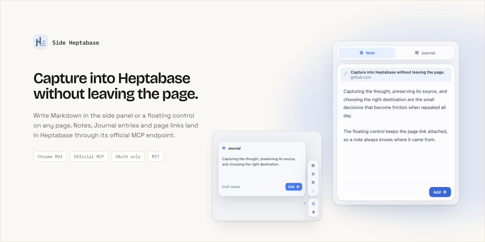
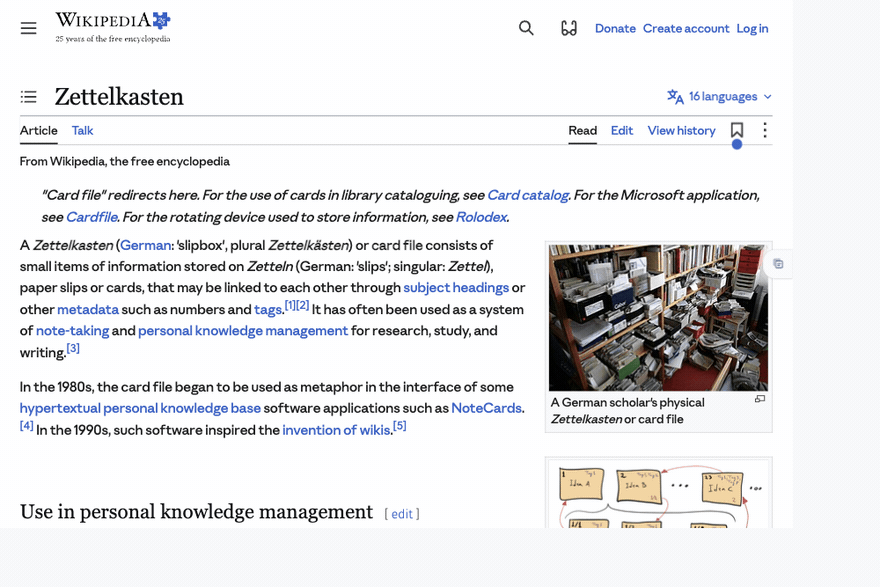

# Side Heptabase

English: [README.md](README.md)

[](https://github.com/RizzoTho/side-heptabase/releases/latest)

<p align="center">
  
</p>

我做 Side Heptabase，是给那些在 Chromium 浏览器里阅读、研究，又希望笔记直接落进 Heptabase 的人。记下想法、保留来源、选择落点，每一步都不难，但一天重复几十次就会打断注意力。插件提供侧栏和网页上的小型悬浮入口。

Side Heptabase 是一个非官方 Chrome 插件，通过 Heptabase 官方 MCP 端点和 OAuth 写入 Note Card、Journal，以及当前页面链接。

## 安装

Side Heptabase 通过 [Releases](https://github.com/RizzoTho/side-heptabase/releases/latest) 页面的 zip 分发。不需要构建，也没有 package 依赖，zip 里就是完整的插件；悬浮入口已在 Dia 中检查。

1. 从最新 Release 下载 `side-heptabase-vX.Y.Z.zip`，解压到一个长期保留的位置。
2. 在 Chrome 打开 `chrome://extensions`，或在 Dia 打开 `dia://extensions`。
3. 开启右上角的**开发者模式**。
4. 点击**加载已解压的扩展程序**，选择解压出来的 `side-heptabase` 文件夹。
5. 点击 Side Heptabase 插件图标，打开侧栏。
6. 点击 **Connect**，在新标签页完成授权。

Chrome 每次启动都会读这个文件夹，所以别删。更新时把新版本解压覆盖进去，然后在插件卡片上点**重新加载**；草稿和设置存在 Chrome storage 里，不会丢。移动文件夹或移除插件会改变 extension ID，需要重新授权 Heptabase。

要改插件本身，就 clone 仓库，直接加载仓库目录。

## 使用

1. 打开想要记录的网页。
2. 在侧栏中用 Markdown 写笔记。
3. 选择 **Note** 或 **Journal**。
4. 点击 **Add**，或按 `Cmd/Ctrl + Enter`。

在普通网页中，hover 悬浮 Meta 入口可展开 Journal、Todo、Note、Link。Hover 图标预览输入框；点击图标或输入框后固定。Link 会复制当前 URL，并把 `[页面标题](URL)` 追加到当天 Journal。Todo 会写成当天 Journal 里的未完成清单项；它**不是** Heptabase 独立 Task App 中的 Todo，因为当前官方 MCP 没有开放创建该类型的工具。左侧小 X 会在本页隐藏悬浮入口，刷新后恢复。

<p align="center">
  
</p>

演示停在本地草稿保存状态，没有向 Heptabase 提交内容。

Settings 可查看 MCP 连接状态，并设置直接点击 Meta 时打开 Chrome 侧栏，或重开上次成功发送的输入类型。一次确认发送成功后会解除固定，鼠标离开悬浮区域时收起。

发送到 Note Card 时，如果笔记以 H1（`#`）开头，会保留它作为卡片标题；否则插件会在开头补上当前页面标题。当前页面的标题与 URL 会作为来源链接追加在笔记末尾。草稿保存在本地，浏览器重启后仍可恢复；登录中断不会清空内容或来源链接，重新授权后也不会自动重发。若发送结果不明，先到 Heptabase 核对，再主动重试，以免重复。

## 权限与隐私

- `sidePanel`：在 Chrome 侧栏中显示编辑器。
- `tabs`：读取当前页面标题与 URL，并将其附在笔记中作为来源。
- `storage`：在 Chrome 中保存 OAuth 会话、设置和未发送草稿；content script 无法读取 token 存储。
- `scripting`：安装或重载本地扩展时，为已经打开的网页补上悬浮入口，不刷新这些标签页。
- HTTP/HTTPS 网页访问权限：显示悬浮入口；不会注入 Heptabase 授权页。
- `clipboardWrite`：选择 Link 时复制当前页面 URL。
- `api.heptabase.com`：完成 Heptabase 授权和笔记写入。

笔记由插件直接发送到 Heptabase。OAuth token 只保存在 Chrome extension storage 中，并且只由 background service worker 处理，不会进入侧栏页面。本项目不运行任何中转服务器。

Side Heptabase 是社区项目，与 Heptabase 官方无隶属或背书关系。

## 项目结构

```text
assets/       README 截图
icons/        插件图标与 README logo
lib/          OAuth 与 Heptabase MCP client
floating/     网页悬浮入口、样式和图标
sidepanel/    侧栏界面与 Markdown 编辑器
background.js Background service worker 与消息路由
manifest.json Chrome Manifest V3 配置
tests/        捕捉与草稿恢复的针对性测试
```

## 限制

- 手动通过 Chrome 的**加载已解压的扩展程序**安装：从 GitHub Releases 下载 zip 并加载解压出来的文件夹。尚未发布到 Chrome Web Store。
- 目前支持纯 Markdown 文本，不支持文件或图片附件。
- Todo 按钮会写入 Journal 清单；官方 MCP 暂不支持创建 Task App Todo。
- 重新安装插件或移动仓库目录可能改变 extension ID，需要重新授权 Heptabase。
- 依赖 Chromium side panel 与 extension storage API。悬浮入口已在 Dia 中检查；完整发送流程尚未在 Dia 实时写入验证。

## License

[MIT](LICENSE)
